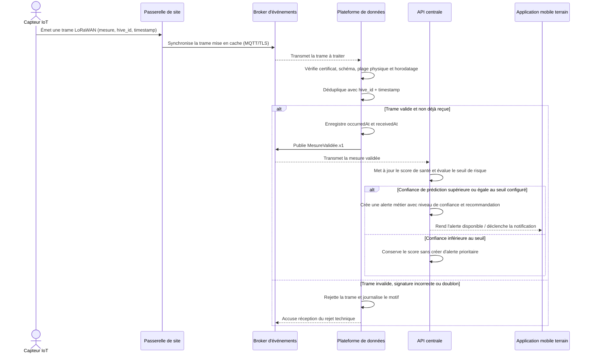

# Séquence Data — De la mesure reçue à l'alerte (UC-T02 / UC-A02)

Le scénario décrit le chemin nominal d'une trame jusqu'à la décision métier. `occurredAt` reste l'horodatage métier ; `receivedAt` permet de mesurer le retard de synchronisation (ADR-002). La clé de déduplication est `hive_id + timestamp`.

## Règles importantes

- Une trame invalide ou rejouée ne produit jamais `MesureValidée.v1`.
- Une mesure retardée est historisée selon `occurredAt` ; elle ne déclenche pas automatiquement une fausse alerte temps réel.
- Le seuil de confiance est configurable par type de ruche/site : sa valeur exacte reste à valider avec BeeAfrica.
- Le diagramme représente une séquence logique. L'entraînement des modèles peut être batch ; l'inférence est déclenchée par les mesures ou par une fenêtre de calcul.
